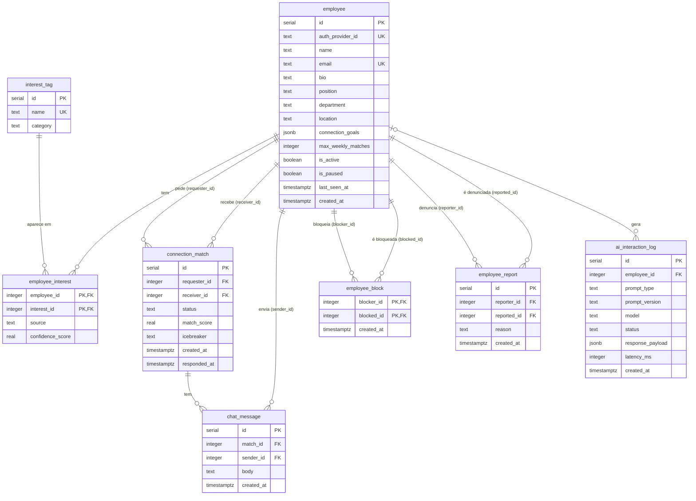

# Arquitetura

## Visão geral

```
Navegador (React + Vite)
   |  HTTPS, JSON, JWT no cabeçalho Authorization
   v
API (Node.js + Express)
   |-- PostgreSQL (pg em produção, PGlite em desenvolvimento e testes)
   |-- Gemini (principal) e Groq (reserva), só para extrair tags e sugerir a abertura da conversa
   '-- Google Sign-In (valida o ID token do login)
```

Tudo roda em planos gratuitos. Não usa Docker.

## Decisões

| Tema | Decisão | Motivo |
|---|---|---|
| Banco | PostgreSQL. Em desenvolvimento e testes, PGlite (PostgreSQL em processo, em memória ou em disco). | O mesmo SQL roda nos dois. Quem clona o projeto roda a API sem instalar banco nem criar conta. |
| Acesso a dados | SQL parametrizado direto com `pg`, sem ORM. | O modelo tem 8 tabelas e poucas consultas; menos camadas para manter. |
| Login | ID token do Google validado no servidor, depois JWT de 8 h. | O front não guarda segredo e a API decide quem entra pela lista de e-mails liberados. |
| Chat | Polling a cada 5 s, só com a aba visível. | Funciona na hospedagem gratuita; WebSocket exigiria outro tipo de serviço. |
| Afinidade | Jaccard ponderado pela raridade da tag (IDF), por eixo (profissional e pessoal), mais 0,05 para unidade diferente quando já há afinidade. | Matemática simples e explicável, sem IA. Evita recomendar a todos quem só tem tags populares. |
| IA | Provedor principal e reserva, timeout, nova tentativa, disjuntor, prazo total e validação da saída. | A IA nunca bloqueia o fluxo: se falhar, a pessoa escolhe as tags manualmente e o chat usa um texto padrão. |

## Regras de produto que a arquitetura garante

- **Sem hierarquia.** Cargo e senioridade não entram no cálculo, na descoberta, nas tags (a normalização recusa) nem no texto da IA (o texto gerado é rejeitado se citar cargo). O cargo só é devolvido nas conexões confirmadas e no perfil depois do match.
- **Sem dados sensíveis na saída da IA.** Tags devolvidas pela IA que tocam em política, religião, saúde, orientação sexual, sindicato ou etnia são descartadas (CA-05, LGPD), e um quebra-gelo que cite esses temas é rejeitado. O filtro vale só para a IA: o que a pessoa digita na revisão de tags não é filtrado. Ele é conservador ("Política de Segurança" também cai); nesse caso a pessoa pode adicionar a tag à mão.
- **Consentimento mútuo.** Match só existe com interesse dos dois lados. Chat e quebra-gelo exigem conexão aceita e sem bloqueio, e quem não participa da conexão recebe 404.
- **Cota semanal.** De 1 a 5 solicitações por semana, de segunda a domingo. A checagem roda em transação com trava, então pedidos simultâneos não passam do limite.
- **Expiração.** Solicitações pendentes há mais de 14 dias expiram.
- **Privacidade.** A API guarda nome, e-mail corporativo, unidade, cidade, interesses, objetivos, bio e cargo (opcional). Cargo e bio só aparecem para outra pessoa depois do match. A pessoa pode pausar a exposição, bloquear, denunciar e excluir os dados (exclusão definitiva em cascata, incluindo os registros de IA).

## IA

A extração de tags envia a bio ao provedor entre as marcas `<bio>` e `</bio>`, tratadas como dado. O quebra-gelo envia só os nomes dos interesses das duas pessoas, nunca cargo, e é gerado uma vez e guardado na conexão.

Parâmetros padrão (variáveis de ambiente no `backend/.env.example`):

| Parâmetro | Valor |
|---|---|
| Timeout por chamada | 2,5 s |
| Nova tentativa | 1, após 0,5 s, em 429, erro 5xx ou timeout |
| Disjuntor | abre após 3 falhas em 60 s |
| Prazo total | 8 s (dá tempo de o provedor reserva responder) |
| Temperatura | 0,1 na extração e 0,4 no quebra-gelo |

O plano gratuito do Gemini pode usar o conteúdo enviado para melhorar produtos do Google. Confirme com a área de privacidade da empresa antes de usar bios reais, ou use um plano pago.

## Dados

Oito tabelas: `employee`, `interest_tag`, `employee_interest`, `connection_match`, `chat_message`, `employee_block`, `employee_report` e `ai_interaction_log`. A fonte do esquema são as migrações em `backend/src/db/migracoes` (`001_esquema_inicial.sql` e `002_ai_log_exclusao_em_cascata.sql`). Na inicialização, `backend/src/db/migrar.js` aplica em ordem as que ainda não constam na tabela `schema_migrations`, cada uma na própria transação. Há um índice único parcial que impede duas conexões ativas para o mesmo par de pessoas, em qualquer direção.

O `ai_interaction_log` registra tipo, versão do prompt, modelo, status e tempo; não guarda a bio.

Tabelas e relações, conforme as migrações:



Todas as chaves estrangeiras apagam em cascata (a do `ai_interaction_log` passou a apagar em cascata na migração `002`). Os nomes únicos de `employee.email` e `interest_tag.name` não diferenciam maiúsculas. A tabela `schema_migrations` (versão, nome e data) é criada por `migrar.js` e fica fora do diagrama.

O arquivo `matchnade_schema.sql`, na raiz, é um dump anterior do banco, mantido só como referência. A API não o lê, e ele difere das migrações:

- `connection_goals` é `text[]`, e não `JSONB`;
- `connection_match` não tem `responded_at` nem `icebreaker`, e `match_score` é `numeric(3,2)`;
- não há o índice parcial do par ativo nem os índices únicos sem diferenciar maiúsculas em `employee.email` e `interest_tag.name` (o dump usa `UNIQUE` simples);
- `department` e `location` são obrigatórios, e os textos são `varchar` com tamanho;
- as datas são `timestamp` sem fuso;
- as chaves estrangeiras de `connection_match`, `chat_message.sender_id`, `employee_block`, `employee_report` e `ai_interaction_log` não apagam em cascata;
- não há os `CHECK` de `connection_match.status`, `interest_tag.category`, `employee.max_weekly_matches` (de 1 a 5) e `employee_interest.source`;
- `ai_interaction_log.model` e `ai_interaction_log.latency_ms` são obrigatórios, e nas migrações aceitam nulo;
- não existe a tabela `schema_migrations`.

## Testes

- `backend/test`: vitest e supertest sobre PGlite em memória. Cobrem afinidade, IA, autenticação, perfil, conexões, chat, bloqueio, cota, expiração e concorrência.
- `e2e`: Playwright em dois tamanhos de tela. Sobe a API e o frontend sozinho e cobre cadastro, match mútuo entre duas pessoas com chat, bloqueio e privacidade.
